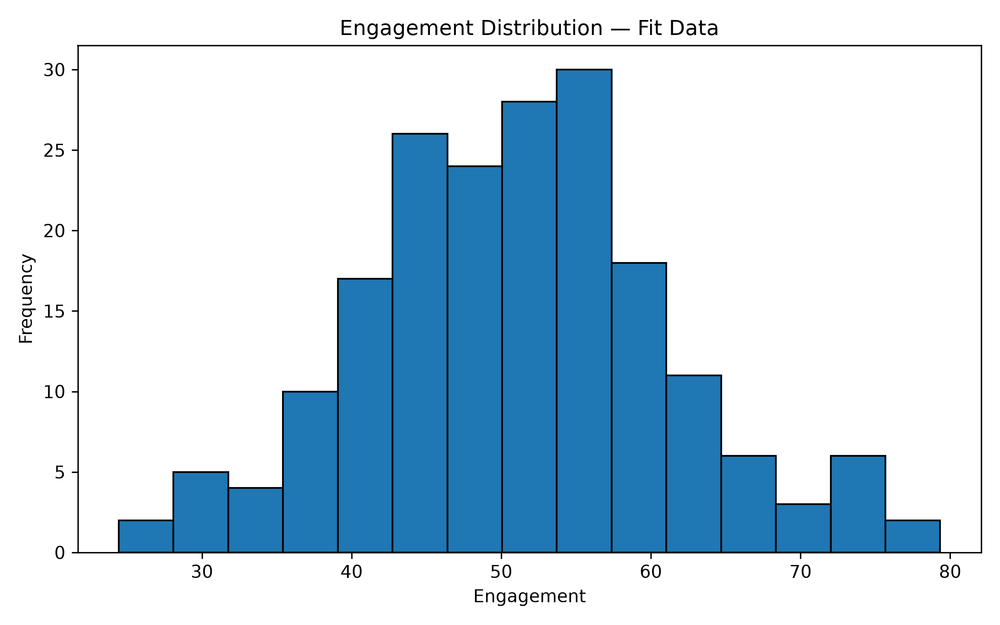
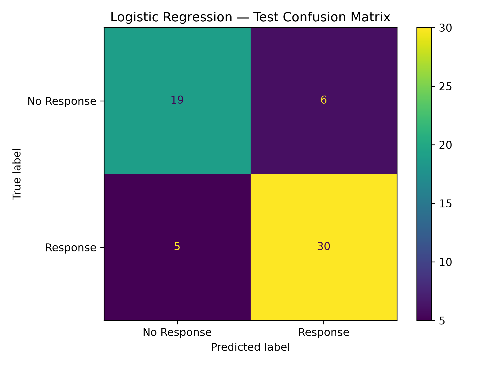
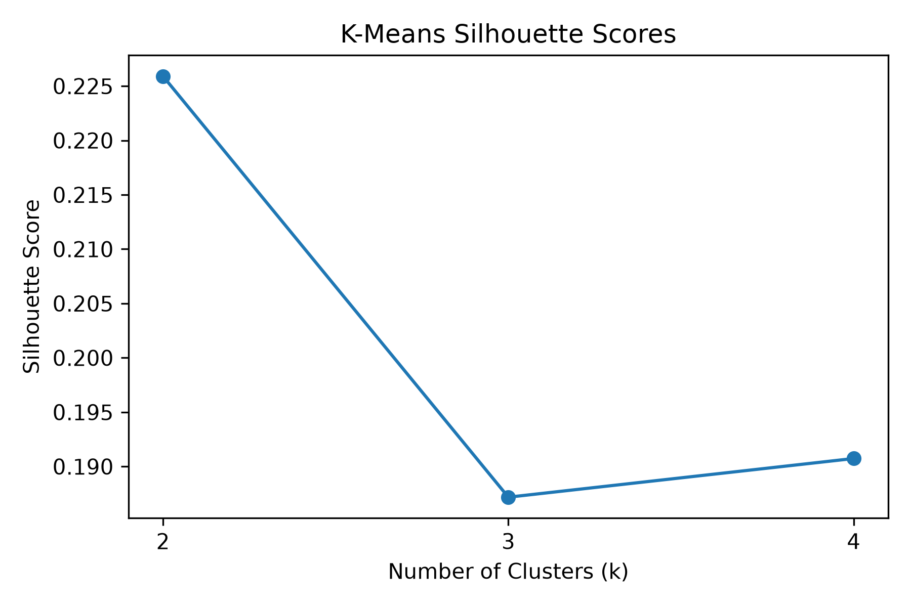
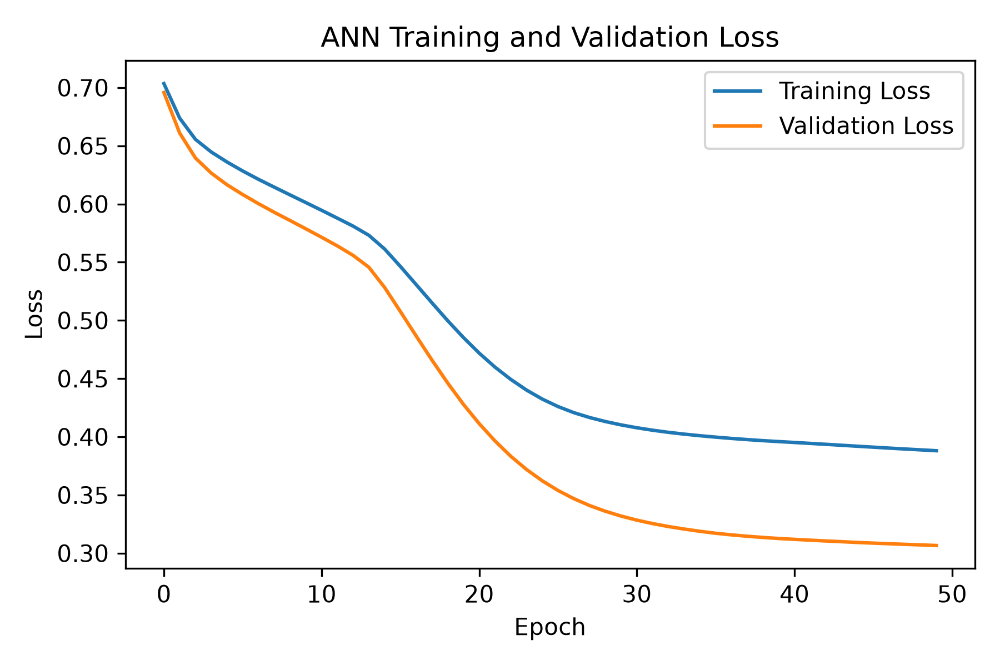

# Campaign Response: Data Analysis and Prediction

**Data Science & AI/ML Practical — Set A**

This project explores customer campaign data, prepares it for modelling, and compares supervised classification, unsupervised clustering, and a small Artificial Neural Network (ANN) for predicting campaign response.

**[📂 **View Project File on Google Drive**](https://drive.google.com/file/d/1jAwnNUMC5M_o8VPTL-cPxwJMMbv_S3BU/view?usp=sharing)**

## Project Objectives

- Inspect the dataset, check missing values and duplicate records, and prepare clean data for analysis.
- Summarise customer engagement with descriptive statistics and a histogram.
- Compare engagement between groups `G1` and `G2` using a two-sided Welch t-test.
- Calculate a covariance matrix, eigenvalues, and eigenvectors for `engagement` and `visits`.
- Split records into fit, validation, and test partitions.
- Impute missing numeric values, one-hot encode `group`, and standardise numeric features.
- Compare a majority-class baseline with Logistic Regression.
- Use K-Means and silhouette scores to select a cluster count and profile segments.
- Train an ANN, monitor validation loss with early stopping, and compare its test metrics with Logistic Regression.
- Export result tables, plots, preprocessing objects, and trained models.

## Repository Structure

```text
Project 3/
├── data/
│   └── raw/
│       └── set_d.csv
├── outputs/
│   ├── figures/
│   │   ├── engagement_histogram.png
│   │   ├── confusion_matrix.png
│   │   ├── kmeans_silhouette.png
│   │   └── ann_loss_curve.png
│   ├── models/
│   │   ├── preprocessing.joblib
│   │   └── ann_model.keras
│   ├── splits.csv
│   ├── statistics_summary.csv
│   ├── inference_results.csv
│   ├── covariance_matrix.csv
│   ├── eigenvalues.csv
│   ├── preprocessing_audit.csv
│   ├── model_metrics.csv
│   ├── test_predictions.csv
│   ├── kmeans_diagnostics.csv
│   ├── clustered_fit.csv
│   ├── cluster_profiles.csv
│   ├── ann_training_info.csv
│   ├── ann_test_predictions.csv
│   └── final_model_comparison.csv
├── Exam.ipynb
└── README.md
```

The notebook creates the output folders when it runs. Output files appear after their corresponding cells have executed successfully.

## Dataset and Features

The notebook's data-generation cell creates a sample CSV at `data/raw/set_d.csv` with 300 generated records, four numeric features, a categorical group, and a binary response target. It introduces missing values into selected numeric columns and appends five duplicate rows so the cleaning steps can be demonstrated. **Important:** the current notebook writes this generated sample to `data/raw/set_d.csv` each time that cell runs. If you want to use your own dataset, edit or skip that cell before running it.

| Column | Description |
|---|---|
| `record_id` | Record identifier; excluded from model predictors |
| `visits` | Numeric customer activity feature |
| `recency` | Numeric recency feature |
| `engagement` | Numeric engagement measure |
| `spend` | Numeric spending feature |
| `group` | Categorical group (`G1` or `G2`) |
| `response` | Binary target label (`0` / `1`) |

The project data is synthetic. Results are intended to demonstrate the workflow and should not be treated as evidence about real customers or campaigns.

## Workflow Details

### 1. Data Review and Cleaning

The notebook checks dataset dimensions, data types, missing values, duplicate rows, and unique record IDs. The generated source contains 305 rows because five duplicate rows are appended; removing exact duplicates leaves 300 records.

### 2. Data Splitting

The cleaned dataset is split using stratification on `response` and a fixed random state:

- **Fit set:** 192 records
- **Validation set:** 48 records
- **Test set:** 60 records

The fit set is used to learn preprocessing settings and train models. The validation set monitors ANN training. The test set is reserved for final model evaluation.

### 3. Descriptive and Inferential Statistics

The notebook calculates observed-value engagement statistics: count, mean, median, and sample standard deviation. It also saves an engagement histogram.

A two-sided Welch independent-samples t-test compares engagement values between `G1` and `G2`, using a significance level of `0.05`. The notebook records the test statistic, p-value, group counts, and a 95% confidence interval for the overall observed engagement mean.

For `engagement` and `visits`, the notebook computes a sample covariance matrix and eigen decomposition. The notebook's written interpretation reports that the largest eigenvalue explains approximately 52% of the total variance for those two features.

### 4. Feature Engineering and Preprocessing

The notebook prepares model features by:

- Applying median imputation to numeric values, with settings learned from the fit partition.
- Creating `engineered_feature = engagement / (recency + 1)`.
- One-hot encoding the `group` feature.
- Standardising numeric features with a scaler fitted on the fit partition.
- Reusing the fitted preprocessing steps for validation and test data.
- Checking partition shapes, finite values, and that `response` and `record_id` are excluded from predictor features.

The prepared model input contains seven predictor features. The fitted imputer, encoder, scaler, and numeric-feature list are saved to `outputs/models/preprocessing.joblib`.

### 5. Supervised Classification

Two models are evaluated against the same held-out test partition:

- **DummyClassifier:** a most-frequent baseline.
- **Logistic Regression:** a binary classifier fitted with `max_iter=1000`.

The notebook reports accuracy, precision, recall, F1-score, and the confusion matrix. Predicted response probabilities are converted to labels with a threshold of `0.5`.

The notebook's displayed confusion-matrix interpretation reports:

- True negatives: **19**
- False positives: **6**
- False negatives: **5**
- True positives: **30**

These values correspond to 49 correct predictions out of 60 test records in the shown run. Check the exported metric files after rerunning the notebook for the latest run-specific results.

### 6. Unsupervised Learning with K-Means

K-Means is tested with `k = 2`, `3`, and `4`, using `n_init=10` and `random_state=42`. Silhouette scores and inertia are recorded. The notebook's interpretation selects **two clusters (`k = 2`)** because this setting has the highest silhouette score among the tested values.

Cluster profiles summarise the feature values for each segment. The notebook describes the groups as lower-engagement and higher-engagement segments and suggests possible re-engagement or follow-up experiments. Cluster IDs are arbitrary labels and are not the same as response classes.

### 7. Artificial Neural Network (ANN)

The ANN uses this architecture:

```text
Input features
      ↓
Dense(16, activation="relu")
      ↓
Dense(8, activation="relu")
      ↓
Dense(1, activation="sigmoid")
```

Training settings from the notebook:

- Loss: binary cross-entropy
- Optimizer: Adam
- Learning rate: `0.001`
- Batch size: `16`
- Maximum epochs: `50`
- Early stopping: monitor `val_loss`, patience `5`, restore best weights
- Random seed: `42`
- Prediction threshold: `0.5`

The notebook plots training and validation loss, saves training information, and evaluates the ANN on the same test records used for Logistic Regression. The final comparison includes accuracy, precision, recall, and F1-score.

## Screenshots

The notebook saves all plots to `outputs/figures/`. GitHub can display these images when the relative paths and folder names are preserved.

### Engagement Distribution



### Logistic Regression — Test Confusion Matrix



### K-Means Silhouette Scores



### ANN Training and Validation Loss



## Technologies Used

- Python
- Pandas and NumPy
- SciPy
- Matplotlib
- scikit-learn
- TensorFlow / Keras
- Jupyter Notebook

## Installation and Usage

### 1. Open the project directory

Run commands from the project root—the folder containing `Exam.ipynb`.

### 2. Install dependencies

```bash
pip install numpy pandas scipy matplotlib scikit-learn tensorflow joblib jupyter
```

TensorFlow installation support depends on the Python version and operating system. If installation fails, use a TensorFlow-supported environment and consult the official TensorFlow installation instructions.

### 3. Start Jupyter Notebook

```bash
jupyter notebook
```

Open `Exam.ipynb` and run the cells in order. The notebook uses relative paths such as `data/raw/set_d.csv` and `outputs/figures/`, so the working directory should be the project root.

> **Dataset note:** The notebook's data-generation cell overwrites `data/raw/set_d.csv` with generated sample data when run. If you intend to use your own dataset, change or skip that cell before running the notebook.

## Output Files

| Output | Purpose |
|---|---|
| `outputs/splits.csv` | Record IDs assigned to fit, validation, and test partitions |
| `outputs/statistics_summary.csv` | Descriptive engagement statistics |
| `outputs/inference_results.csv` | Welch t-test and confidence-interval summary |
| `outputs/covariance_matrix.csv` | Covariance matrix for engagement and visits |
| `outputs/eigenvalues.csv` | Eigenvalues and variance shares |
| `outputs/preprocessing_audit.csv` | Checks on the prepared model inputs |
| `outputs/model_metrics.csv` | Baseline and Logistic Regression metrics |
| `outputs/test_predictions.csv` | Test-set classification predictions |
| `outputs/kmeans_diagnostics.csv` | K-Means inertia and silhouette scores |
| `outputs/clustered_fit.csv` | Fit-set cluster assignments |
| `outputs/cluster_profiles.csv` | Feature summaries by cluster |
| `outputs/ann_training_info.csv` | ANN training configuration and validation-loss summary |
| `outputs/ann_test_predictions.csv` | ANN test predictions and probabilities |
| `outputs/final_model_comparison.csv` | Final comparison of Logistic Regression and ANN |
| `outputs/figures/` | Four saved PNG plots |
| `outputs/models/` | Saved preprocessing objects and trained ANN |

## Mathematical Answers and Worked Results

The values below are the results recorded in the notebook run. They can change if the generated data, random seed, split, or model settings are changed.

### M1 — Descriptive Statistics for Engagement

For the fit partition, the notebook uses all observed `engagement` values (\(n=192\)).

- **Count:** \(n=192\)
- **Mean:** \(\bar{x}=\frac{\sum_{i=1}^{n}x_i}{n}=51.0018\)
- **Median:** \(51.4050\)
- **Sample standard deviation:** \(s=\sqrt{\frac{\sum_{i=1}^{n}(x_i-\bar{x})^2}{n-1}}=10.2890\)

**Answer:** Average engagement is approximately **51.00**, and the sample standard deviation is approximately **10.29**.

### M2 — Welch Two-Sample t-Test

The hypotheses are:

- \(H_0:\mu_{G1}=\mu_{G2}\)
- \(H_1:\mu_{G1}\ne\mu_{G2}\)
- Significance level: \(\alpha=0.05\)

Welch's test statistic is

\[
t=\frac{\bar{x}_1-\bar{x}_2}
{\sqrt{\frac{s_1^2}{n_1}+\frac{s_2^2}{n_2}}}
\]

Notebook results:

| Quantity | Result |
|---|---:|
| G1 sample size | 84 |
| G2 sample size | 108 |
| Welch t-statistic | 0.7230 |
| p-value | 0.4707 |
| Significance level | 0.05 |
| 95% CI for overall mean engagement | (49.5372, 52.4665) |

**Decision:** Since \(0.4707 > 0.05\), **fail to reject \(H_0\)**. This run does not provide statistically significant evidence that the mean engagement differs between G1 and G2. This is not proof that the means are identical.

For the overall mean, the confidence interval is calculated as

\[
\bar{x}\pm t_{0.975,n-1}\frac{s}{\sqrt{n}}
\]

which gives approximately **(49.54, 52.47)**.

### M3 — Covariance Matrix and Eigenvalues

The notebook uses the 181 fit records with non-missing values for both `engagement` and `visits`. Each column is centred by subtracting its mean, then the sample covariance matrix is calculated using

\[
S=\frac{X_c^\top X_c}{n-1}
\]

The resulting covariance matrix is

\[
S \approx
\begin{bmatrix}
103.6571 & 4.1181\\
4.1181 & 103.0612
\end{bmatrix}
\]

The eigenvalues are approximately:

- \(\lambda_1=107.4880\)
- \(\lambda_2=99.2303\)

The largest eigenvalue's variance share is

\[
\frac{\lambda_1}{\lambda_1+\lambda_2}
=\frac{107.4880}{107.4880+99.2303}
\approx0.51997=52.00\%
\]

**Answer:** The first principal direction accounts for approximately **52.00%** of the total variance across these two features.

### F1 — Data Split Calculation

After removing 5 duplicate rows, there are **300 unique records**. The split is stratified and uses `random_state=42`.

| Partition | Records | Share of cleaned data |
|---|---:|---:|
| Fit | 192 | 64% |
| Validation | 48 | 16% |
| Test | 60 | 20% |
| **Total** | **300** | **100%** |

The fit and validation sets together form 80% of the data; 20% is held out for final testing.

### F2 — Feature Engineering and Scaling

The engineered feature is defined as

\[
\text{engineered\_feature}=
\frac{\text{engagement}}{\text{recency}+1}
\]

For example, when engagement is \(45.81\) and recency is \(31.83\),

\[
\frac{45.81}{31.83+1}\approx1.3954
\]

The notebook then standardises each numeric feature:

\[
z=\frac{x-\mu_{\text{fit}}}{\sigma_{\text{fit}}}
\]

The scaler and imputer are fitted only on the fit partition and reused on validation and test data. The final model input has **7 features**: five numeric features (including the engineered feature) and two one-hot encoded group columns. The preprocessing audit reports **0 missing values** and **0 infinite values** in the fit feature matrix.

The fit-set medians used for numeric imputation are:

| Feature | Median |
|---|---:|
| `visits` | 49.610 |
| `recency` | 50.600 |
| `engagement` | 51.405 |
| `spend` | 50.595 |

### S1 — Logistic Regression Classification

The test set has 60 records. At a probability threshold of 0.5, the confusion matrix is

\[
\begin{bmatrix}
TN & FP\\
FN & TP
\end{bmatrix}
=
\begin{bmatrix}
19 & 6\\
5 & 30
\end{bmatrix}
\]

The metric formulas and notebook answers are:

\[
\text{Accuracy}=\frac{TP+TN}{TP+TN+FP+FN}
=\frac{30+19}{60}=0.8167
\]

\[
\text{Precision}=\frac{TP}{TP+FP}
=\frac{30}{30+6}=0.8333
\]

\[
\text{Recall}=\frac{TP}{TP+FN}
=\frac{30}{30+5}=0.8571
\]

\[
F1=2\frac{\text{Precision}\times\text{Recall}}
{\text{Precision}+\text{Recall}}=0.8451
\]

| Metric | Majority baseline | Logistic Regression |
|---|---:|---:|
| Accuracy | 0.5833 (58.33%) | 0.8167 (81.67%) |
| Precision | — | 0.8333 |
| Recall | — | 0.8571 |
| F1-score | — | 0.8451 |

**Answer:** Logistic Regression improves test accuracy from **58.33%** for the majority baseline to **81.67%** in this run. It correctly identifies 30 responders and 19 non-responders, while making 6 false-positive and 5 false-negative predictions.

### U1 — K-Means Cluster Selection

The notebook compares \(k=2,3,4\). The silhouette score is

\[
s=\frac{b-a}{\max(a,b)}
\]

where \(a\) is the mean distance to points in the same cluster and \(b\) is the lowest mean distance to another cluster. A larger score generally indicates better separation.

| Clusters \(k\) | Inertia | Silhouette score |
|---:|---:|---:|
| 2 | 713.0304 | **0.2259** |
| 3 | 613.5511 | 0.1872 |
| 4 | 541.6453 | 0.1907 |

**Answer:** Select **\(k=2\)** because it has the highest silhouette score among the tested values. The fit partition has 192 records: cluster 0 contains **109** records and cluster 1 contains **83**.

Original-scale cluster profile results:

| Cluster | Visits | Recency | Engagement | Spend | Engineered feature | Records |
|---|---:|---:|---:|---:|---:|---:|
| 0 — Lower engagement | 49.37 | 55.25 | 46.09 | 50.18 | 0.83 | 109 |
| 1 — Higher engagement | 49.54 | 44.17 | 57.45 | 50.97 | 1.29 | 83 |

Cluster labels are arbitrary and do not indicate response class.

### D1–D3 — ANN Architecture and Results

The ANN architecture is:

```text
7 input features
      ↓
Dense(16, ReLU)
      ↓
Dense(8, ReLU)
      ↓
Dense(1, Sigmoid)
```

- Hidden layers: 16 and 8 units, ReLU activation.
- Output layer: 1 sigmoid unit, giving a response probability.
- Loss: binary cross-entropy.
- Optimizer: Adam, learning rate \(0.001\).
- Batch size: 16.
- Maximum epochs: 50.
- Early stopping: monitor validation loss, patience 5, restore best weights.
- Classification threshold: 0.5.
- Trainable parameters reported by the notebook: **273**.

ANN test metrics from the recorded run:

| Metric | ANN |
|---|---:|
| Accuracy | 0.8167 (81.67%) |
| Precision | 0.8158 |
| Recall | 0.8857 |
| F1-score | 0.8493 |

**Answer:** In the recorded run, ANN accuracy matches Logistic Regression at approximately **81.67%**. ANN has higher recall (**88.57%**) and F1-score (**84.93%**) than Logistic Regression, while Logistic Regression has higher precision (**83.33%** vs **81.58%**). Which model is preferable depends on whether the application prioritises finding more responders or limiting false-positive predictions.

### Overall Mathematical Conclusion

- Mean engagement in the fit partition: **51.0018**.
- Welch test: **\(t=0.7230,\ p=0.4707\)**; not significant at 0.05.
- Largest eigenvalue variance share: **52.00%**.
- Best tested K-Means choice: **\(k=2\)**, silhouette **0.2259**.
- Logistic Regression: accuracy **81.67%**, precision **83.33%**, recall **85.71%**, F1 **84.51%**.
- ANN: accuracy **81.67%**, precision **81.58%**, recall **88.57%**, F1 **84.93%**.

These are the outputs recorded in the notebook and are specific to its synthetic dataset and current settings; rerunning with different data or settings can change them.

---

## Evaluation Metrics

- **Accuracy:** fraction of all predictions that are correct.
- **Precision:** proportion of predicted responders who are actual responders.
- **Recall:** proportion of actual responders correctly identified.
- **F1-score:** harmonic mean of precision and recall.
- **Confusion matrix:** counts of correct and incorrect predictions by class.
- **Silhouette score:** measure of how separated the K-Means clusters are.

Use the CSV outputs for the exact results from the run you want to report. Metrics from a small synthetic test set are illustrative, not guarantees of real-world campaign performance.

## Author

**Name:** DHARMIK PANSURIYA
**Project:** Campaign Response: Data Analysis and Prediction  
**Course:** Data Science & AI/ML Practical — Set A
